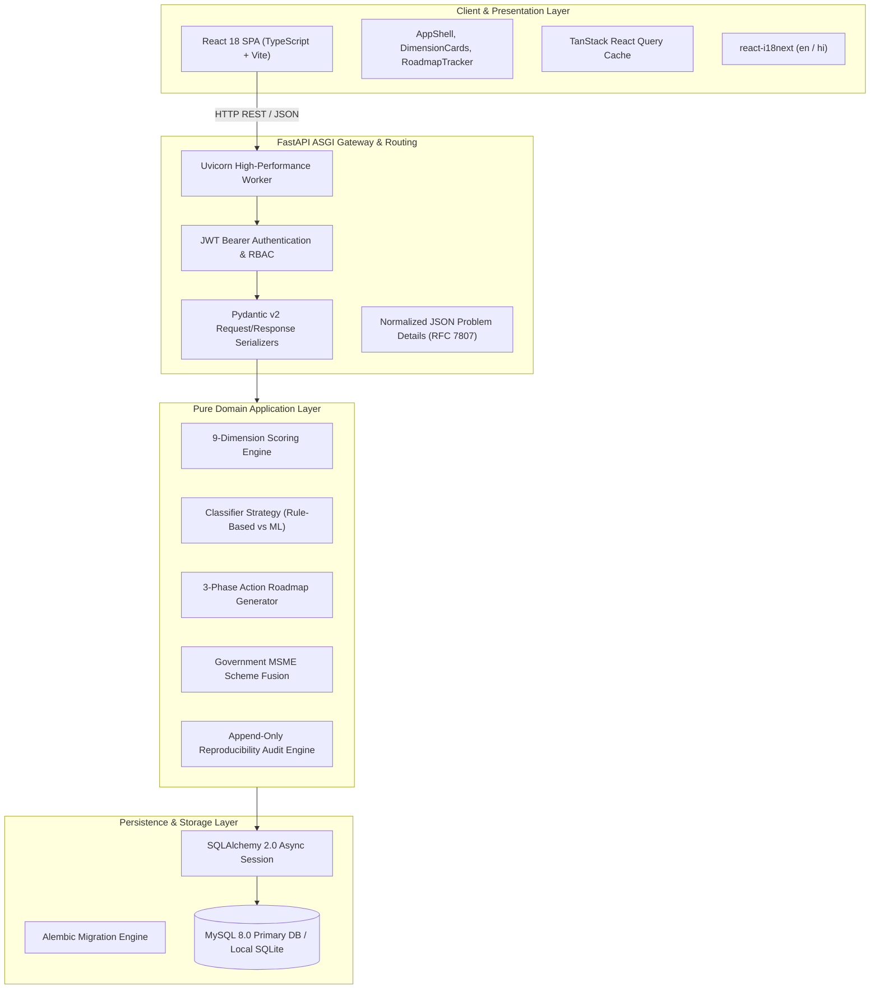
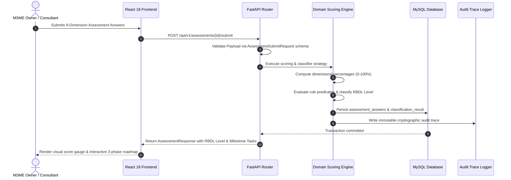

# System Architecture & Technical Specifications — DigiMitra (डिजीमित्र)

> **Document Version:** 1.0.0  
> **Architecture Pattern:** Clean Architecture Modular Monolith  
> **Backend Framework:** FastAPI (Python 3.11+) + SQLAlchemy 2.0 Async + Uvicorn  
> **Frontend Framework:** React 18 (TypeScript) + Vite + Tailwind CSS + TanStack Query  
> **Persistence:** MySQL 8.0+ / SQLite 3 (aiosqlite) with Alembic Migrations  

---

## 1. High-Level Architectural Topology

DigiMitra is architected as a **Modular Monolith** with strict domain boundary isolation. It provides the deployment simplicity and zero-network-hop operational latency of a single service while maintaining pure architectural decoupling that permits individual modules (such as the Scoring Engine or Chatbot) to be extracted into independent microservices if scale dictates.

---

## 2. Layered Responsibilities & Inversion of Control

### 2.1 Client Layer (`frontend/src`)
- **State Management:** TanStack Query handles server-state synchronization, automatic refetching, and caching.
- **Routing:** React Router v6 provides deterministic client-side page routing (`/`, `/register`, `/assessment`, `/roadmap`, `/initiatives`, `/history`, `/contact`).
- **HTTP Client:** Centralized Axios instance with automatic authorization header injection and localized error interception.

### 2.2 API Layer (`backend/app/api/v1`)
- **FastAPI Endpoints:** Thin controllers that validate HTTP payloads via Pydantic schemas, invoke domain services, and return strict DTO responses.
- **Dependency Injection:** Database sessions (`get_async_session`), authenticated current user (`get_current_user`), and active language locale (`get_locale`) are injected via FastAPI dependencies.

### 2.3 Domain Layer (`backend/app/domain`)
- **Zero Framework Coupling:** Domain classes contain pure business logic with no imports of FastAPI, HTTP, or direct SQL sessions.
- **Strategy Pattern (`classifier_strategy.py`):** Defines an abstract base class `ClassifierStrategy` with concrete implementations:
  1. `RuleBasedClassifierStrategy`: Deterministic, interpretable AST condition evaluator for MVP.
  2. `MLClassifierStrategy`: Trained Scikit-Learn Random Forest / Gradient Boosting pipeline for research experiments.

### 2.4 Persistence Layer (`backend/app/repositories` & `backend/app/models`)
- **Repository Pattern:** Generic `BaseRepository` provides standardized CRUD methods (`create`, `get_by_id`, `list`, `update`, `delete`).
- **SQLAlchemy 2.0 Async:** All operations execute using `async/await` non-blocking database queries with connection pooling.

---

## 3. Data Flow Execution Lifecycle

---

## 4. Architectural Quality Attributes & Non-Functional Design

1. **Reproducibility & Auditability:** Every classification is logged with rule IDs, trigger predicates, and input parameters.
2. **Horizontal Scalability:** Stateless ASGI workers can scale behind Nginx or cloud load balancers.
3. **Data Protection:** Implements Indian DPDP Act 2023 compliance with user consent tracking, role isolation, and sanitized exports.
