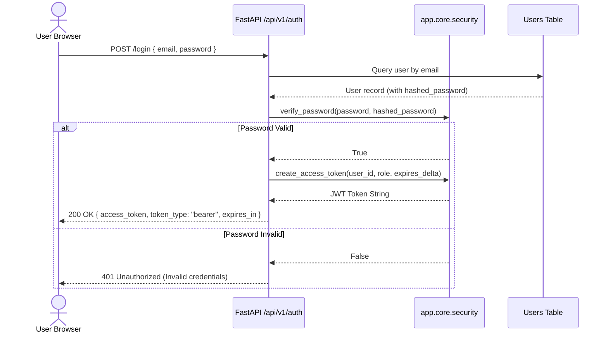

# Authentication, Authorization & Security Architecture — DigiMitra (डिजीमित्र)

> **Security Baseline:** OWASP Top 10 + Indian Digital Personal Data Protection (DPDP) Act 2023  
> **Auth Method:** Stateless JWT Bearer Tokens (HS256) + Passlib Bcrypt  
> **Rule Safety:** Abstract Syntax Tree (AST) condition parser (Zero `eval()`/`exec()`)  

---

## 1. Authentication Lifecycle

DigiMitra enforces a stateless, cryptographically secure authentication workflow:



### 1.1 Password Hashing & Salts
- Uses **bcrypt** with an adaptive work factor (12 rounds).
- Raw passwords are never logged, cached in memory, or stored in plaintext.

### 1.2 JWT Token Specifications
- **Algorithm:** `HS256` signed using the server's `SECRET_KEY`.
- **Payload Claims:**
  - `sub`: User UUID string.
  - `role`: Role identifier (`msme_owner`, `consultant`, `admin`).
  - `exp`: Expiration timestamp (default 60 minutes for access tokens).
  - `type`: `access` or `refresh`.

---

## 2. Role-Based Access Control (RBAC)

FastAPI dependencies enforce strict access controls on endpoints:

```python
async def require_role(required_role: str):
    async def role_checker(current_user: User = Depends(get_current_user)):
        if current_user.role != required_role and current_user.role != "admin":
            raise HTTPException(
                status_code=status.HTTP_403_FORBIDDEN,
                detail="Insufficient permissions for this operation."
            )
        return current_user
    return role_checker
```

| Role | Permissions |
| :--- | :--- |
| **`msme_owner`** | Create/manage own business, take assessments, view own roadmaps and history. |
| **`consultant`** | View client business diagnostics, export assessment audit reports. |
| **`admin`** | Full access: manage system rules, view anonymized datasets, trigger seeder scripts. |

---

## 3. Defense-in-Depth Security Controls

### 3.1 Zero Raw SQL Injection
All interactions with MySQL / SQLite utilize SQLAlchemy 2.0 async parameterized queries. No raw dynamic string concatenation is permitted anywhere in repository layers:
```python
# SECURE (Used in DigiMitra repositories):
query = select(Business).where(Business.owner_id == user_id)
result = await session.execute(query)
```

### 3.2 Safe Condition Parser (Zero `eval()`)
To evaluate business rule predicates safely without risking remote code execution (RCE), DigiMitra utilizes a custom AST parser in `backend/app/domain/rbdl/safe_condition_parser.py`:
- Parses conditions strictly against allowed nodes (`Compare`, `Name`, `Constant`, `BoolOp`).
- Rejects function calls, imports, loops, and attribute mutation.

### 3.3 DPDP Act 2023 Compliance
1. **Purpose Limitation:** Business demographic data is collected exclusively for readiness diagnostics.
2. **Explicit Consent:** Registration requires explicit consent for data processing.
3. **Right to Erasure:** Users can request deletion of their business assessment history.
4. **Data Minimization:** No Aadhaar numbers, personal bank passwords, or customer credit card details are ever requested or stored.
