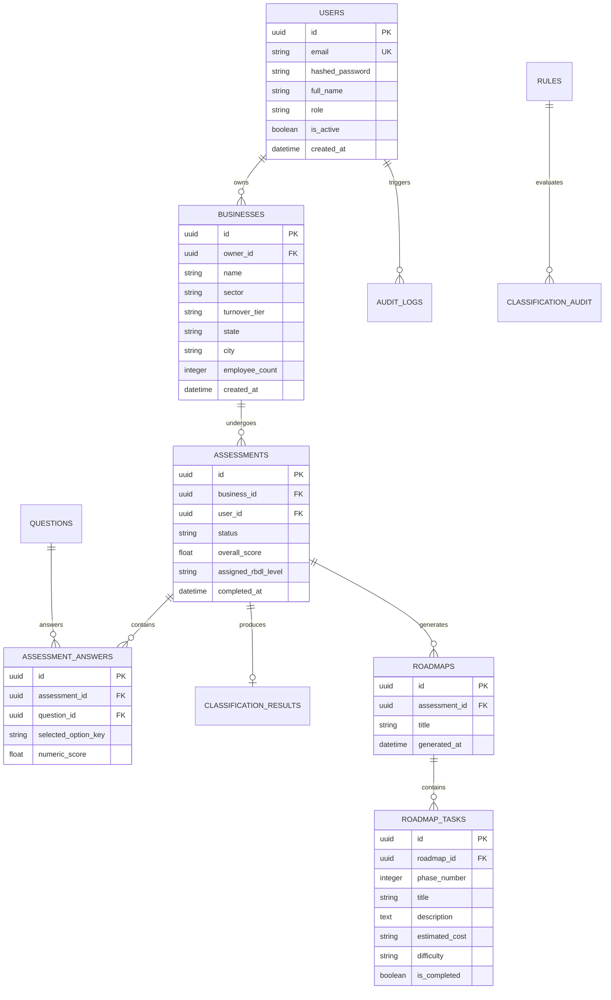

# Database Architecture & Schema Specification — DigiMitra (डिजीमित्र)

> **Database Engines:** MySQL 8.0+ (Production) / SQLite 3 via `aiosqlite` (Local Dev & Unit Tests)  
> **ORM Framework:** SQLAlchemy 2.0 (Declarative Async Mapping)  
> **Migration Manager:** Alembic (Async Environment)  

---

## 1. Entity-Relationship Overview



---

## 2. Core Tables Specification

### 2.1 `users`
Stores authenticated users (MSME business owners, external consultants, and administrators).
- `id` (VARCHAR(36), PK): UUID v4 identifier.
- `email` (VARCHAR(255), UNIQUE, NOT NULL): User's primary login email.
- `hashed_password` (VARCHAR(255), NOT NULL): Bcrypt-hashed password.
- `full_name` (VARCHAR(150), NOT NULL): User's display name.
- `role` (VARCHAR(50), DEFAULT 'msme_owner'): `msme_owner`, `consultant`, `admin`.
- `is_active` (BOOLEAN, DEFAULT TRUE): Soft-disable switch.
- `created_at` (TIMESTAMP, DEFAULT CURRENT_TIMESTAMP).

### 2.2 `businesses`
Contains registered enterprise profiles and demographic parameters.
- `id` (VARCHAR(36), PK): UUID v4.
- `owner_id` (VARCHAR(36), FK `users.id`, NOT NULL): Enterprise owner.
- `name` (VARCHAR(200), NOT NULL): Commercial enterprise name.
- `sector` (VARCHAR(100), NOT NULL): Sector category (e.g. `Retail & Trade`).
- `sub_category` (VARCHAR(100), NULLABLE): Granular sub-category.
- `turnover_tier` (VARCHAR(50), NOT NULL): Micro (`< ₹25L`), Small (`₹25L–₹5Cr`), Medium (`₹5Cr–₹250Cr`).
- `city` (VARCHAR(100)), `state` (VARCHAR(100)): Geographic location for regional scheme matching.
- `employee_count` (INTEGER, DEFAULT 1).

### 2.3 `assessments` & `assessment_answers`
- `assessments`: Tracks the lifecycle of a digital readiness evaluation (`in_progress`, `completed`). Holds the computed aggregate score and assigned RBDL level (`Level 0`, `Level 1`, `Level 2`, `Level 3`).
- `assessment_answers`: Stores individual question responses with score contribution and chosen options.

### 2.4 `roadmaps` & `roadmap_tasks`
- Stores personalized phased action plans generated by the recommendation fusion service.
- Each `roadmap_task` tracks `phase_number` (1 = 30 days, 2 = 90 days, 3 = 180 days), tool suggestions, estimated costs, and completion status.

---

## 3. Database Indexes & Query Optimization

| Table Name | Indexed Columns | Index Purpose |
| :--- | :--- | :--- |
| `users` | `email` (Unique B-Tree) | O(1) authentication lookup during login |
| `businesses` | `owner_id` (B-Tree) | Fast retrieval of all enterprises belonging to a user |
| `assessments` | `business_id, created_at` | Historical trend tracking and paginated history view |
| `assessment_answers` | `assessment_id` | Quick retrieval of full response sets for scoring |
| `roadmap_tasks` | `roadmap_id, phase_number` | Structured milestone grouping for frontend rendering |

---

## 4. Alembic Migration Workflow

Alembic configurations reside in `backend/alembic.ini` and `backend/alembic/env.py`.

```bash
# 1. Generate an automatic migration from SQLAlchemy models
py -m alembic revision --autogenerate -m "add_table_or_column_name"

# 2. Review the generated script in backend/alembic/versions/

# 3. Apply migrations to the database
py -m alembic upgrade head

# 4. Rollback last migration if needed
py -m alembic downgrade -1
```
