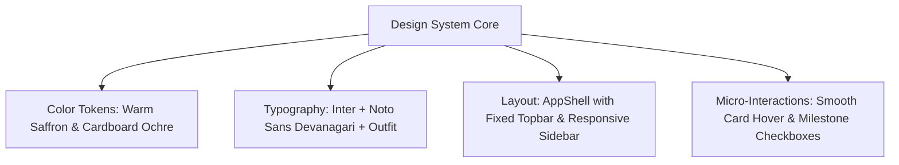

# UI/UX Design System Specification — DigiMitra (डिजीमित्र)

> **Theme Name:** Bharat Digital Theme  
> **Target Framework:** React 18 + Tailwind CSS + Lucide Icons  
> **Key Attributes:** Accessible, Warm Indian Aesthetics, Mobile-First Responsive, High Information Density  

---

## 1. Design Philosophy & Aesthetic Identity

The **Bharat Digital Theme** combines the warmth of traditional Indian commercial trust with modern, clean Scandinavian software ergonomics. Rather than sterile corporate blues or generic tech themes, DigiMitra utilizes a rich saffron/terracotta primary accent (`#F0592A`), warm cream page backgrounds (`#FDF8F3`), and deep obsidian slate typography (`#241C15`).



---

## 2. Color Palette & Semantic Tokens

### 2.1 Core Palette

| Token Name | Hex Code | Tailwind Equivalent | Usage Context |
| :--- | :--- | :--- | :--- |
| **Brand Primary (Saffron)** | `#F0592A` | `brand-500` / `#F0592A` | Primary CTA buttons, active tabs, progress highlights |
| **Brand Primary Dark** | `#D4471B` | `brand-600` / `#D4471B` | Button hover states, active navigation indicators |
| **Surface Cream** | `#FDF8F3` | `bg-[#FDF8F3]` | Main application body background |
| **Card Surface (Pure White)** | `#FFFFFF` | `bg-white` | Elevated card containers, modals, form panels |
| **Border Soft** | `#F3E8DE` | `border-[#F3E8DE]` | Subtle card dividers and table lines |
| **Text Primary (Dark Obsidian)**| `#241C15` | `text-[#241C15]` | Headings, primary labels, core body text |
| **Text Secondary (Warm Slate)**| `#6B6056` | `text-[#6B6056]` | Subtitles, helper captions, metadata timestamps |

### 2.2 Semantic Level Badges

| Maturity Level | Background | Text Color | Icon | Visual Meaning |
| :--- | :--- | :--- | :--- | :--- |
| **Level 0 (Manual)** | `#FEE2E2` | `#991B1B` | AlertCircle | Traditional, urgently requires digitization steps |
| **Level 1 (Discovery)**| `#FEF3C7` | `#92400E` | Sparkles | Early digital adoption in place |
| **Level 2 (Standard)** | `#DBEAFE` | `#1E40AF` | CheckCircle | Operational consistency achieved |
| **Level 3 (Strategic)**| `#D1FAE5` | `#065F46` | Award | Advanced integrated enterprise |

---

## 3. Typography Hierarchy

DigiMitra incorporates dual-script typography to guarantee flawless rendering across both English and Hindi text:

1. **Heading Display:** `Outfit` (sans-serif) — Clean geometric punch for hero titles, score numbers, and section headers.
2. **Body Text (English):** `Inter` (sans-serif) — Highly legible across all resolutions, optical sizing.
3. **Body Text (Hindi):** `Noto Sans Devanagari` — Engineered specifically for clear Devanagari ligatures and matras.

```css
/* Font Family Definition in Tailwind */
font-sans: ['Inter', 'Noto Sans Devanagari', 'sans-serif'],
font-display: ['Outfit', 'sans-serif']
```

---

## 4. Key Component Architecture

### 4.1 Global App Shell
- **Top Navigation Bar:** Persistent brand logo, active business profile selector, global language toggle (`EN` / `हिन्दी`), and user avatar menu.
- **Side Rail / Breadcrumbs:** Provides persistent access to Dashboard, Assessment, Roadmap, Initiatives, Learning Hub, and History.

### 4.2 Interactive Dimension Score Card
- Displays 0–100% radial or horizontal score bar for each of the 9 dimensions.
- High-contrast visual indicators: Red (<40%), Yellow (40–70%), Green (>70%).
- Quick-action button: *View Knowledge Nuggets & Flashcards*.

### 4.3 Phased Roadmap Milestone Card
- Categorized by time horizon:
  - **Phase 1 (Immediate - 30 Days):** Low cost, high impact.
  - **Phase 2 (Short-Term - 90 Days):** Process formalization.
  - **Phase 3 (Medium-Term - 180 Days):** Systems integration.
- Includes estimated cost badge (e.g. `Free`, `₹500 - ₹2,000/mo`, `One-time ₹15,000`), difficulty score (`Beginner`, `Intermediate`, `Advanced`), and external tool guides.
