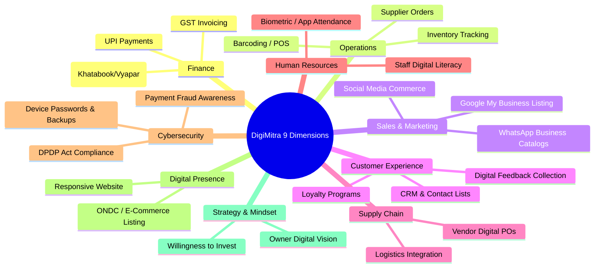

# Feature Development & Capabilities — DigiMitra (डिजीमित्र)

> **Document Version:** 1.0.0  
> **Key Capabilities:** 9-Dimension Assessment, RBDL Levels, Roadmap Generator, MSME Schemes, Flashcards, i18n  

---

## 1. 9-Dimensional Assessment Framework

DigiMitra evaluates enterprises across 9 foundational dimensions designed specifically for the operational realities of Indian businesses:

---

## 2. Requirement-Based Digitalization Levels (RBDL 0–3)

### 2.1 Level 0: Traditional Manual
- **Profile:** Paper khata registers, cash transactions, zero online discovery.
- **Immediate Focus:** Onboarding to UPI QR codes, opening a dedicated business bank account, and claiming Google Business profile.

### 2.2 Level 1: Basic Digital Discovery
- **Profile:** Accepts UPI, uses WhatsApp for customer communication, listed on Google Maps.
- **Immediate Focus:** Transitioning from paper khata to mobile billing apps (Vyapar / Khatabook), maintaining digital customer contacts.

### 2.3 Level 2: Operational Standardization
- **Profile:** Uses digital POS/billing, generates GST compliant invoices, tracks inventory digitally.
- **Immediate Focus:** Adopting cloud accounting, automating reorder reminders, setting up customer loyalty incentives.

### 2.4 Level 3: Strategic Digital Enterprise
- **Profile:** Centralized ERP/CRM, multi-channel sales (in-store + ONDC/website), data-informed inventory planning.
- **Immediate Focus:** Advanced analytics, predictive demand forecasting, automated marketing funnels.

---

## 3. Dynamic Phased Roadmap Generator

The roadmap generator (`backend/app/domain/roadmap_generator.py`) parses the output of the classification engine and structures a concrete, bite-sized transformation plan:

| Milestone Horizon | Focus Area | Cost Expectation | Examples |
| :--- | :--- | :--- | :--- |
| **Phase 1: 30 Days (Quick Wins)** | Immediate hygiene & leakage plugging | Free to < ₹1,000 | Set up UPI soundbox, claim Google Maps listing, configure WhatsApp Business auto-replies |
| **Phase 2: 90 Days (Process Formalization)** | Core operational stabilization | ₹1,000 – ₹5,000/mo | Implement barcode scanning, digital bookkeeping, regular data backups |
| **Phase 3: 180 Days (Strategic Scaling)** | Expansion & e-commerce readiness | ₹10,000 – ₹50,000 | Join ONDC network, launch branded web storefront, implement basic CRM |

---

## 4. Government MSME Initiatives Fusion Layer

DigiMitra directly links identified gaps to verified Government of India initiatives:
- **PMEGP (Prime Minister’s Employment Generation Programme):** Capital subsidy for business modernization.
- **CGTMSE (Credit Guarantee Fund Trust for Micro and Small Enterprises):** Collateral-free credit for machinery and digital equipment.
- **ZED Certification Scheme (Zero Defect Zero Effect):** Financial assistance for quality assessment and digital upgrading.
- **Digital MSME Scheme:** Subsidized access to cloud computing services.

---

## 5. Bilingual Localization (i18n) Engine

Every user-facing artifact supports real-time switching between English and Hindi:
- **Backend:** JSON translation files in `backend/locales/en/` and `backend/locales/hi/`.
- **Frontend:** `react-i18next` with automatic browser language detection and instant UI re-rendering without page refreshes.
