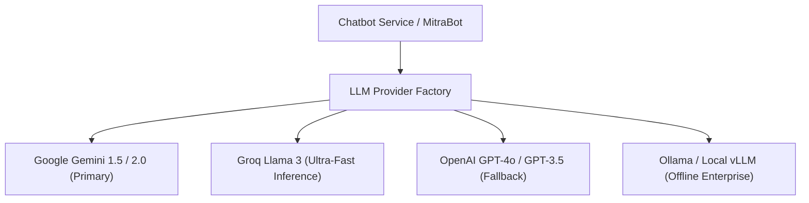
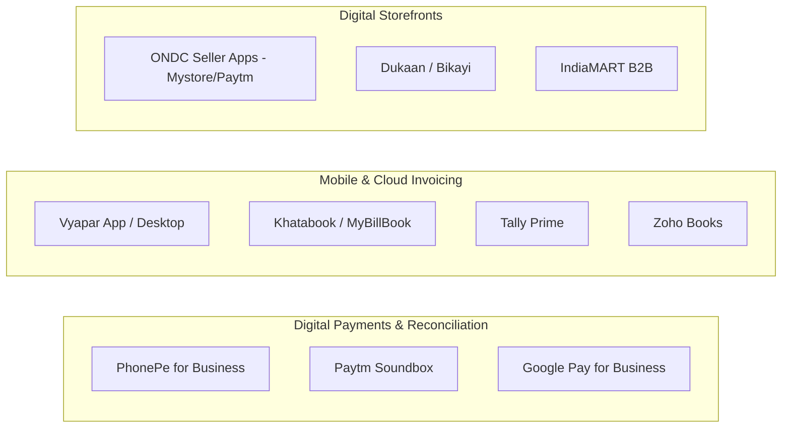

# External System & Service Integrations — DigiMitra (डिजीमित्र)

> **Document Version:** 1.0.0  
> **Key Integration Vectors:** LLM Providers, Government of India MSME Portals, Payment & Accounting Ecosystems, ONDC  

---

## 1. Large Language Model (LLM) Providers

DigiMitra incorporates a multi-provider LLM abstraction layer (`backend/app/core/llm/providers.py`) designed for zero-vendor lock-in.



### 1.1 Provider Configuration (`backend/.env`)
```ini
LLM_PROVIDER=gemini  # options: gemini, groq, openai, local
GEMINI_API_KEY=your_gemini_api_key_here
GROQ_API_KEY=your_groq_api_key_here
OPENAI_API_KEY=your_openai_api_key_here
LLM_TEMPERATURE=0.3  # Low temperature for deterministic, factual advisory
```

---

## 2. Government of India MSME Portal Hooks

DigiMitra prepares structured payload exports and deep-linking integrations with key national portals:

| Government Portal | Purpose | DigiMitra Touchpoint |
| :--- | :--- | :--- |
| **Udyam Registration Portal** | Official MSME certificate generation | Pre-fills business category, turnover tier, and NIC codes. |
| **MSME Samadhaan** | Delayed payment monitoring and grievance filing | Roadmap milestone guide for recovering receivables. |
| **ZED Portal (Zero Defect Zero Effect)** | Manufacturing quality certification | Maps operations dimension scores to ZED Bronze/Silver eligibility. |
| **GeM (Government e-Marketplace)**| Public procurement for MSMEs | Guides Level 2/3 businesses on listing catalog products. |

---

## 3. Financial & Accounting Ecosystem Alignment

DigiMitra generates roadmap tool recommendations mapped to vetted commercial and open-source applications popular across Indian commercial hubs:



---

## 4. ONDC (Open Network for Digital Commerce) Integration Hooks

For retail, wholesale, and food services categorized under RBDL Level 2 or Level 3, DigiMitra provides an automated readiness checklist:
1. **Catalog Digitization:** Export product catalogs into standard ONDC Beckn protocol JSON format.
2. **Inventory Sync:** Integration hooks with local inventory software to emit real-time stock availability.
3. **Logistics Handshake:** Guides the enterprise in selecting integrated third-party delivery partners (e.g., Dunzo, Shadowfax, Shiprocket).
