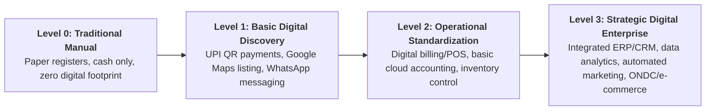

# Product Requirements Document (PRD) — DigiMitra (डिजीमित्र)

> **Document Version:** 1.0.0  
> **Target Product:** DigiMitra AI Digital Consultant Framework  
> **Target Audience:** Indian Micro, Small, and Medium Enterprises (MSMEs), Technical Consultants, Research Evaluators  

---

## 1. Executive Summary & Vision

**DigiMitra** is an enterprise-grade digital consultant framework developed to address the systemic challenges of digital adoption across the 63+ million Micro, Small, and Medium Enterprises (MSMEs) in India. Traditional digital transformation frameworks are tailored for large multinational corporations with dedicated IT budgets, making them cost-prohibitive, technically overwhelming, and structurally misaligned for Indian local retail shops, wholesale distributors, artisanal manufacturers, and service micro-enterprises.

DigiMitra pioneers the **Requirement-Based Digitalization Level (RBDL)** paradigm, an adaptive 4-tier digital maturity index (Levels 0 through 3) that diagnoses an enterprise's current capability across 9 operational dimensions and outputs a deterministic, cost-optimized, and phase-prioritized transformation roadmap.

---

## 2. Problem Statement & User Pain Points

### 2.1 The MSME Dilemma in India
1. **Ad-Hoc Tool Sprawl:** Enterprises purchase point solutions (accounting apps, CRM, social media tools) without strategic cohesion, leading to abandoned tools and wasted capital.
2. **Language and Technical Jargon Barriers:** Most consulting tools are exclusively in English and use corporate jargon that alienates non-metro business owners.
3. **One-Size-Fits-All Fallacy:** Tier-1 ERP solutions impose excessive operational overhead on 3-person retail businesses.
4. **Lack of Trust & Regulatory Awareness:** Uncertainty regarding data privacy (DPDP Act 2023) and lack of visibility into applicable Government of India MSME subsidies.

---

## 3. User Personas

| Persona | Archetype | Turnover Tier | Primary Pain Point | DigiMitra Goal |
| :--- | :--- | :--- | :--- | :--- |
| **Ramesh Kumar** | Kirana / Retail Merchant | < ₹25 Lakhs (Micro) | Paper ledger books, cash reconciliation leakage | Transition from Level 0 to Level 1 (UPI, basic digital bookkeeping). |
| **Sunita Sharma** | Apparel Wholesaler | ₹25L – ₹1 Crore (Small) | Inventory stockouts, uncoordinated WhatsApp orders | Achieve Level 2 (centralized inventory, automated invoices, basic CRM). |
| **Vikram Patel** | Light Auto-Parts Manufacturer | ₹1 Cr – ₹5 Crore (Small/Medium)| Machine downtime, manual order pipeline | Transition from Level 2 to Level 3 (ERP integration, predictive stocking, B2B e-commerce). |
| **Rajeev Verma** | MSME Digital Consultant | External Professional | Time-consuming manual audits and subjective recommendations | Automated diagnostics, verifiable audit trails, and reproducible roadmap reports. |

---

## 4. Requirement-Based Digitalization Levels (RBDL)

DigiMitra classifies businesses into 4 scientifically bounded maturity levels:

---

## 5. Core System Capabilities & Scope

### 5.1 In-Scope Capabilities (v1.0)
- **Sector Taxonomy:** 6 primary enterprise sectors (Retail & Trade, Manufacturing, Hospitality & Food Services, Healthcare, Logistics, Professional Services).
- **9-Dimension Readiness Assessment:** Diagnostic questionnaire covering Finance, Operations, Sales & Marketing, Customer Experience, Supply Chain, Human Resources, Cyber Security, Digital Presence, and Strategic Mindset.
- **Deterministic Classification Strategy:** Safe Rule-Based Decision Logic (RBDL) ensuring 100% reproducible classifications without black-box unpredictability.
- **Phased Roadmap Generator:** Actionable milestones categorized into Immediate (30 Days), Short-Term (90 Days), and Medium-Term (180 Days) horizons.
- **Government MSME Scheme Matching:** Contextual matching with schemes including PMEGP, CGTMSE, ZED Certification, and Digital MSME initiatives.
- **Bilingual Localization (i18n):** Complete dynamic language switching between English and Hindi (हिन्दी).
- **DPDP Act Compliant Audit Trails:** Append-only cryptographic trace of user inputs and recommendation logic for academic and compliance verification.

### 5.2 Out-of-Scope (Deferred to v2.0)
- Direct automated submission of loan applications to bank APIs.
- Automated POS sync hardware drivers.

---

## 6. Functional & Non-Functional Requirements

### 6.1 Functional Requirements (FR)
- **FR-01:** System shall permit secure user registration and login using JWT Bearer authentication.
- **FR-02:** System shall allow users to register and manage multiple enterprise profiles.
- **FR-03:** System shall calculate real-time dimension scores (0–100%) and evaluate the composite RBDL level.
- **FR-04:** System shall generate an interactive roadmap where tasks can be toggled and tracked.
- **FR-05:** System shall provide interactive flashcards with bite-sized digitalization best practices.

### 6.2 Non-Functional Requirements (NFR)
- **NFR-01 (Performance):** Assessment evaluation and roadmap generation must respond in under 500ms.
- **NFR-02 (Security):** Passwords hashed with bcrypt; zero raw SQL injection vectors via SQLAlchemy 2.0 parameterized models.
- **NFR-03 (Accessibility):** Adhere to WCAG 2.1 AA standards; responsive layout across mobile, tablet, and desktop screens.
- **NFR-04 (Reliability):** Database transactions must ensure atomic rollback on failure; audit traces are immutable.
