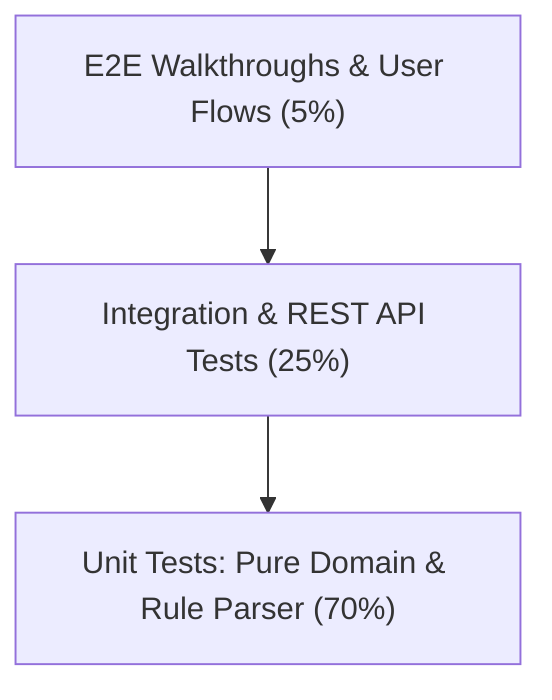

# Quality Assurance & Testing Suite — DigiMitra (डिजीमित्र)

> **Backend Testing:** Pytest + pytest-asyncio + httpx  
> **Frontend Testing:** Vitest + React Testing Library + jsdom  
> **Test Coverage Target:** >85% across domain logic and critical API paths  

---

## 1. Testing Strategy Overview

DigiMitra enforces a strict pyramid testing methodology:



---

## 2. Backend Automated Test Suite (Pytest)

### 2.1 Test Directory Layout
```
backend/tests/
├── unit/
│   ├── test_config.py                    # Environment and settings validation
│   ├── test_safe_condition_parser.py     # AST rule validator security tests
│   ├── test_rbdl_definitions.py          # Level boundaries and score formulas
│   ├── test_jwt_security.py              # Password hashing and token expiry
│   ├── test_chatbot_provider_safety.py   # LLM prompt safety and bounds
│   └── test_flashcards_and_government.py # Schema integrity of seeded content
└── integration/
    ├── test_health_api.py                # Database ping and system status endpoint
    ├── test_auth_and_registration.py     # Full user signup, login, and JWT cycle
    ├── test_business_crud.py             # Business profile lifecycle
    ├── test_assessment_flow.py           # Answer submission and RBDL scoring
    └── test_product_apis.py              # Roadmaps, tasks, and scheme filters
```

### 2.2 Running Backend Tests
Execute from the workspace root or inside `backend/`:

```bash
# Run all unit and integration tests
py -m pytest backend/tests

# Run with verbose output and test execution durations
py -m pytest backend/tests -v --durations=10

# Run specific domain test
py -m pytest backend/tests/unit/test_safe_condition_parser.py -v
```

---

## 3. Frontend Automated Test Suite (Vitest)

### 3.1 Test Directory Layout
```
frontend/tests/
├── setup.ts                              # jsdom and testing-library matchers
├── DimensionFlashcards.test.tsx          # Interactive learning modal tests
├── FeatureGuideModal.test.tsx            # Onboarding tour modal tests
├── GovernmentSchemesAndFeedback.test.tsx # Scheme directory and rating widget tests
├── ShareModal.test.tsx                   # Social and PDF export share tests
└── ContactView.test.tsx                  # Contact form validation tests
```

### 3.2 Running Frontend Tests
Execute from inside `frontend/`:

```bash
cd frontend

# Run complete Vitest suite
npm run test

# Run tests in continuous watch mode
npm run test -- --watch
```

---

## 4. Quality Gate & Continuous Integration (CI) Matrix

| Test Category | Target Component | Success Criteria | Execution Frequency |
| :--- | :--- | :--- | :--- |
| **Linting & Types** | Backend (mypy/flake8) & Frontend (tsc) | Zero errors, strict type safety | Pre-commit & CI |
| **AST Rule Parser** | `safe_condition_parser.py` | 100% of malicious injection vectors blocked | Every build |
| **Domain Scoring** | `scoring_engine.py` | 100% deterministic score calculations | Every build |
| **API Health** | `/api/v1/health` | HTTP 200 OK with healthy DB component | Deployment health check |
