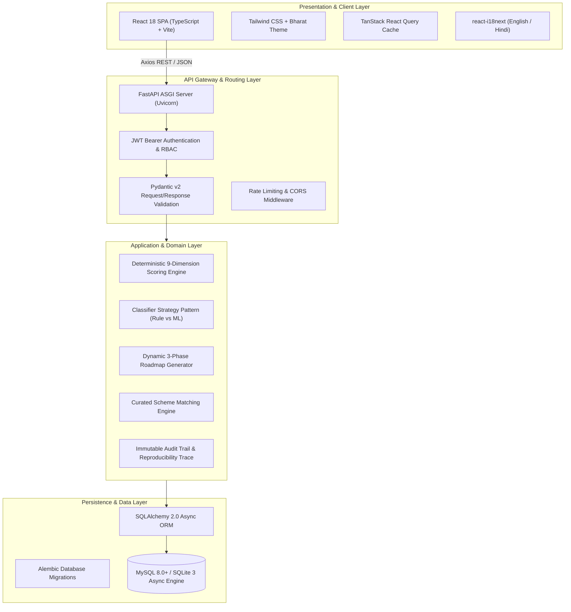

# System Architecture & Technical Specifications

> **Project:** DigiMitra (डिजीमित्र) — AI Digital Consultant for Indian MSMEs  
> **System Topology:** High-Performance Modular Monolith  
> **Target Production Platforms:** Linux / Windows / Containerized Kubernetes  

---

## 1. Architectural Style & Design Principles

DigiMitra is engineered as a **Clean-Architecture Modular Monolith** that enforces strict separation of concerns, data privacy compliant with the Indian Digital Personal Data Protection (DPDP) Act 2023, and seamless interchangeability between rule-based heuristics and machine learning scoring strategies.

---

## 2. Layered Responsibilities

### 2.1 Client Layer (`frontend/src`)
- **Technology:** React 18, TypeScript, Vite, Tailwind CSS, TanStack Query, Axios.
- **Role:** Delivers an intuitive, accessible, high-performance responsive web dashboard for MSME owners and consultants.
- **Key Modules:**
  - `pages/Assessment.tsx`: Step-by-step interactive questionnaire covering 9 core digitalization dimensions.
  - `pages/DigitalRoadmap.tsx`: Interactive milestone tracker with step checkboxes, difficulty badges, and resource links.
  - `pages/MSMEInitiatives.tsx`: Verified directory of central and state MSME schemes with dynamic eligibility filtering.
  - `pages/A11ResearchInstrument.tsx`: Comprehensive academic evaluation and psychometric testing workbench.

### 2.2 API Layer (`backend/app/api/v1`)
- **Technology:** FastAPI, Pydantic v2, Python 3.11+.
- **Role:** Handles HTTP routing, input validation, serialization, CORS policies, authentication, and HTTP error normalization.
- **Key Routers:**
  - `/api/v1/auth`: JWT login, registration, password hashing with bcrypt.
  - `/api/v1/businesses`: Business profile CRUD, sector classification, turnover tiers.
  - `/api/v1/assessments`: Assessment creation, answer submission, historical progress retrieval.
  - `/api/v1/recommendations`: Multi-dimensional score calculation, phased roadmap generation, scheme fusion.
  - `/api/v1/health`: System health status, database ping, and uptime monitoring.

### 2.3 Domain Layer (`backend/app/domain`)
- **Technology:** Pure Python with zero external HTTP or database framework coupling.
- **Role:** Encapsulates business logic, digital maturity level formulas (RBDL 0–3), safe condition parser, and rule evaluation algorithms.
- **Key Components:**
  - `classifier_strategy.py`: Strategy interface implementing `RuleBasedClassifier` and `MLClassifierStrategy`.
  - `scoring_engine.py`: Weighted deterministic scoring across 9 dimensions (Finance, Operations, Sales, etc.).
  - `roadmap_generator.py`: Algorithmic generation of 30-day, 90-day, and 180-day milestone action items.

### 2.4 Persistence Layer (`backend/app/models` & `backend/app/repositories`)
- **Technology:** SQLAlchemy 2.0 Async, Alembic, MySQL 8.0 / aiosqlite.
- **Role:** Data mapping, asynchronous query execution, transaction management, and connection pooling.
- **Tables:** `businesses`, `users`, `assessments`, `assessment_answers`, `recommendations`, `roadmaps`, `audit_traces`.

---

## 3. Security & DPDP Act Compliance

1. **Zero Raw SQL Injection:** All database queries utilize SQLAlchemy 2.0 parameterized expressions.
2. **Safe Rule Evaluation:** Conditions are parsed using an Abstract Syntax Tree (AST) safe validator without `eval()` or `exec()`.
3. **Stateless Authentication:** Cryptographically signed JWT tokens with expiration handling.
4. **Data Privacy:** PII and business assessment records are strictly isolated with role-based access control.
