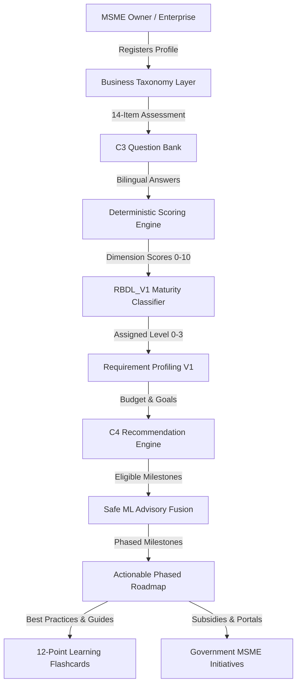

# 01. DigiMitra — Product Overview & Vision

## 1. Executive Summary
**DigiMitra** is an enterprise-grade, research-grounded digitalization platform designed specifically for Micro, Small, and Medium Enterprises (MSMEs) in India. While multinational corporations possess the capital and dedicated IT teams to adopt enterprise resource planning (ERP) suites and cloud infrastructure, India's 63+ million MSMEs face severe barriers: fragmented knowledge, fear of financial loss, lack of standardized guidance, and predatory software vendor pitches.

DigiMitra solves this fundamental economic challenge by providing a **neutral, objective, scientifically validated digitalization diagnostic and step-by-step implementation roadmap**.

## 2. Core Value Propositions
1. **Zero-Conflict Objectivity**: DigiMitra does not sell software, take commissions, or push proprietary vendors. All recommendations are derived through deterministic rules and open-source/frugal best practices.
2. **Context-Aware Pragmatism**: Recognizes that a street-side vendor with Rs 0 budget cannot adopt SAP or Salesforce. Every recommendation is gated by verified hardware capabilities and monthly budget tiers.
3. **Bilingual Democratization**: Entire workflow operates seamlessly in English and Hindi, eliminating linguistic exclusion for Tier-2, Tier-3, and rural business owners.
4. **Phased Actionability**: Avoids overwhelming owners with multi-year projects; organizes transformation into Phase 1 (Quick Wins), Phase 2 (Core Digitalization), and Phase 3 (Strategic Growth).
5. **Government Empowerment**: Connects enterprises directly with verified central and state initiatives (Udyam, ZED, TReDS, GeM, ONDC, CGTMSE, Vishwakarma, MLUPY) with verified official URLs.

## 3. Architecture Philosophy
- **Deterministic Guardrails First**: Critical maturity levels and recommendation prerequisites are governed by deterministic rule engines (RBDL_V1 and C4).
- **Machine Learning as Non-Authoritative Advisory**: Machine learning models provide personalization and ranking adjustments within the strict boundaries established by rule engines.
- **Privacy & Security**: Built on zero-trust RBAC, bcrypt salted passwords, stateless JWT authentication, and strict input sanitization.\n