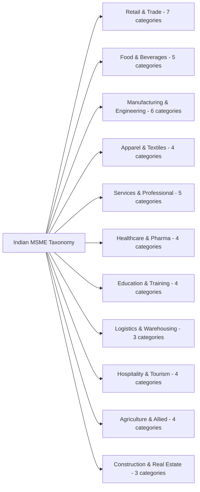

# 03. Business Taxonomy Specification

## 1. Taxonomy Structure
DigiMitra organizes the Indian MSME landscape into an exhaustive **11-Sector, 49-Category** hierarchical taxonomy. Each node contains typical operational needs, standard digital tools, and recommended digital evolution trajectories.

## 2. Sectoral Mapping Matrix

| Sector Code | Sector Name | Subcategories Count | Typical Primary Needs | Standard Software Tools |
| :--- | :--- | :--- | :--- | :--- |
| `RETAIL` | Retail & Trade | 7 | Fast checkout, barcode scanning, credit ledger | Vyapar, Marg, Khatabook, POS |
| `FOOD_BEV` | Food & Beverages | 5 | Recipe costing, table management, delivery integration | Petpooja, POSist, Swiggy/Zomato |
| `MFG` | Manufacturing & Engineering | 6 | Job-work tracking, bill of materials (BOM), machinery log | Tally ERP, Busy, Custom ERP |
| `TEXTILES` | Apparel & Textiles | 4 | Size/color matrix inventory, bulk order tracking | Marg Textiles, Wings ERP |
| `SERVICES` | Services & Professional | 5 | Appointment scheduling, service billing, client history | Zoho Books, Google Workspace |
| `HEALTH` | Healthcare & Pharma | 4 | Batch/expiry management, schedule H compliance | Marg Pharma, MedPlus POS |
| `EDU` | Education & Training | 4 | Fee tracking, student attendance, parent comms | Teachmint, Classpro |
| `LOGISTICS` | Logistics & Warehousing | 3 | Waybill tracking, fleet fuel logs, warehouse slotting | LogiNext, Transoft |
| `HOSPITALITY` | Hospitality & Tourism | 4 | Room occupancy, OTA channel sync, guest invoicing | Hotelogix, eZee Frontdesk |
| `AGRI` | Agriculture & Allied | 4 | Mandi rate tracking, harvest batching, cold storage | AgriCentral, e-NAM portal |
| `CONSTRUCT` | Construction & Real Estate | 3 | Site material ledger, contractor milestone billing | Powerplay, PlanGrid |\n