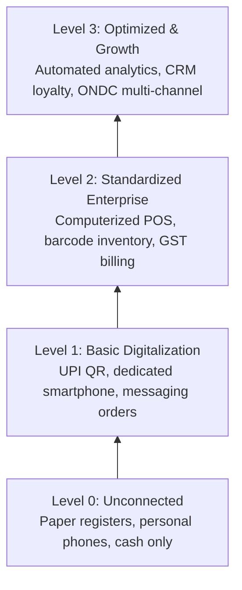

# 04. Digital Maturity Framework (RBDL_V1)

## 1. The Four Readiness-Based Digitalization Levels (RBDL)
The RBDL_V1 framework provides an objective, four-tier classification grounded in empirical enterprise research:

### Level Characteristics:
- **Level 0 (Unconnected)**: Manual paper registers; reliance on personal phones; no formal digital presence; cash dominant.
- **Level 1 (Basic Digitalization)**: Merchant UPI QR code active; dedicated business smartphone; order intake via WhatsApp; basic digital khata.
- **Level 2 (Standardized Digitalization)**: Computerized accounting (Tally/Vyapar); inventory barcode tracking; digital GST invoicing; Google Business Profile verified.
- **Level 3 (Optimized & Growth)**: Executive BI dashboards; integrated CRM loyalty workflows; multi-channel commerce (ONDC/GeM); 3-2-1 automated backup.

## 2. Hard Ceiling Invariants
To prevent artificial inflation of digitalization scores by vanity metrics (e.g., having an Instagram account without billing software), RBDL_V1 enforces strict architectural ceiling rules:
1. **Device Ceiling**: If an enterprise has no dedicated smartphone or computer, its level is strictly capped at **Level 0**, regardless of transaction volume.
2. **Bookkeeping Ceiling**: If record keeping is 100% paper-based, the enterprise cannot exceed **Level 1**.
3. **Data Integrity Ceiling**: Level 3 requires active digital inventory and digital accounting records maintained for at least 6 months.\n