# 05. Assessment Question Bank (C3 Specification)

## 1. Instrument Overview
The C3 Diagnostic Instrument comprises **14 scientifically constructed, mutually orthogonal questions**. Each question targets specific operational dimensions and features fully translated bilingual answer choices.

```mermaid
graph TD
    Q1[Q1: Device Access] --> D1[Hardware Infrastructure]
    Q2[Q2: Internet Reliability] --> D1
    Q3[Q3: Digital Literacy] --> D2[Digital Human Skills]
    Q4[Q4: Digital Presence] --> D3[Customer Presence]
    Q5[Q5: Messaging & Comms] --> D4[Customer Communication]
    Q6[Q6: Bookkeeping Methods] --> D5[Record Keeping]
    Q7[Q7: Invoicing Method] --> D5
    Q8[Q8: Payment Acceptance] --> D6[Digital Payments]
    Q9[Q9: Supplier Payments] --> D6
    Q10[Q10: Inventory Tracking] --> D7[Inventory Management]
    Q11[Q11: Stock Auditing] --> D7
    Q12[Q12: Data Usage & Decisions] --> D8[Data-Driven Decisions]
    Q13[Q13: Backup & Security] --> D8
    Q14[Q14: Growth Digitalization] --> D9[Strategic Growth]
```

## 2. Item Mapping and Weights
- Every question maps to 1 primary dimension and up to 2 secondary cross-cutting dimensions.
- Point values range from 0 (completely manual/absent) to 3 (fully automated/cloud-integrated).
- All question texts, explanations, and options are stored in `backend/app/domain/assessment/` and mirrored in JSON catalogs for localization.\n