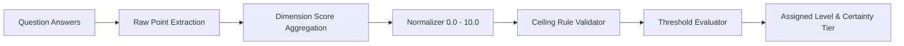

# 06. Scoring & Classification Engine Specification

## 1. Deterministic Dimension Scoring
Dimension scores are computed on a normalized **0.0 to 10.0 scale** across all 9 operational dimensions:
$$\text{Score}_{d} = \left( \frac{\sum_{i \in Q_d} w_i \cdot \text{Points}_i}{\sum_{i \in Q_d} w_i \cdot \text{MaxPoints}_i} \right) \times 10.0$$

## 2. Golden Test Suite Verification
The classification engine is safeguarded by 163+ golden test suites:
- Boundary cases around threshold transitions (e.g. 3.99 vs 4.00).
- Contradictory input patterns (e.g. claiming ERP without devices).
- Deterministic invariance guarantees: identical inputs guarantee identical outputs under all conditions.\n