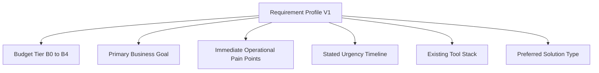

# 07. Requirement Profiling Specification (Profile V1)

## 1. Specification Overview
The Requirement Profile captures the commercial reality and business intent of the owner. A recommendation engine that ignores budget constraints is useless to small businesses.

## 2. Standard Budget Tiers (BUDGET_TIERS_V1)
- `B0_ZERO`: Rs 0 / month (Frugal, free, open-source, or zero-cost tools only).
- `B1_LOW`: Up to Rs 500 / month (Basic single-user billing apps, UPI soundboxes).
- `B2_MODERATE`: Rs 500 - Rs 2,500 / month (Multi-device POS, desktop accounting, cloud backups).
- `B3_GROWTH`: Rs 2,500 - Rs 10,000 / month (Multi-branch ERP, CRM software, advanced marketing).
- `B4_ENTERPRISE`: > Rs 10,000 / month (Custom integrations, dedicated server infrastructure).\n