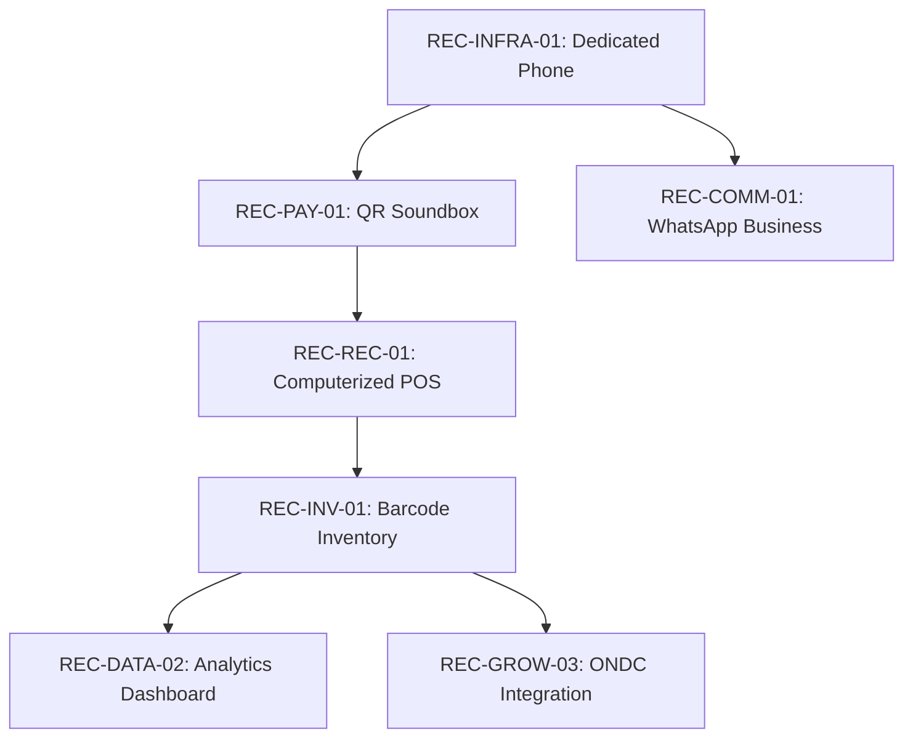

# 08. Recommendation Engine (C4 Specification)

## 1. Eligibility & Prerequisite DAG
The C4 recommendation engine evaluates recommendations as a Directed Acyclic Graph (DAG). An advanced action cannot be recommended until its foundational dependencies are satisfied.

## 2. Priority Scoring Formula
Eligible recommendations are ranked according to the formula:
$$\text{Priority} = w_g \cdot \text{GoalAlignment} + w_p \cdot \text{PainPointImpact} + w_u \cdot \text{UrgencyMultiplier} - w_c \cdot \text{CostEffort}$$
Feasible-now items always precede budget-deferred actions.\n