# 09. Phased Roadmap Generator Specification

## 1. Implementation Horizons
Roadmaps translate unordered recommendations into a sequence of milestones grouped across three distinct phases:

```mermaid
gantt
    title MSME Phased Digitalization Roadmap
    dateFormat  X
    axisFormat %d
    section Phase 1: Quick Wins
    Setup Dedicated Smartphone :active, 0, 7
    Deploy Merchant QR Soundbox :active, 5, 14
    Activate WhatsApp Business :active, 10, 20
    section Phase 2: Core Next Steps
    Computerized GST Billing : 20, 45
    Barcode Stock Tagging : 35, 60
    Google Business Profile : 40, 55
    section Phase 3: Strategic Growth
    Executive BI Dashboards : 60, 90
    CRM & Customer Loyalty : 70, 100
    ONDC Commerce Expansion : 80, 120
```

## 2. Milestone State Lifecycle
Each task milestone transitions through deterministic states:
`PENDING` -> `IN_PROGRESS` -> `COMPLETED` or `SKIPPED`.
Skipping a task requires a valid business reason (e.g., "Budget shortage" or "Alternative tool in use").\n