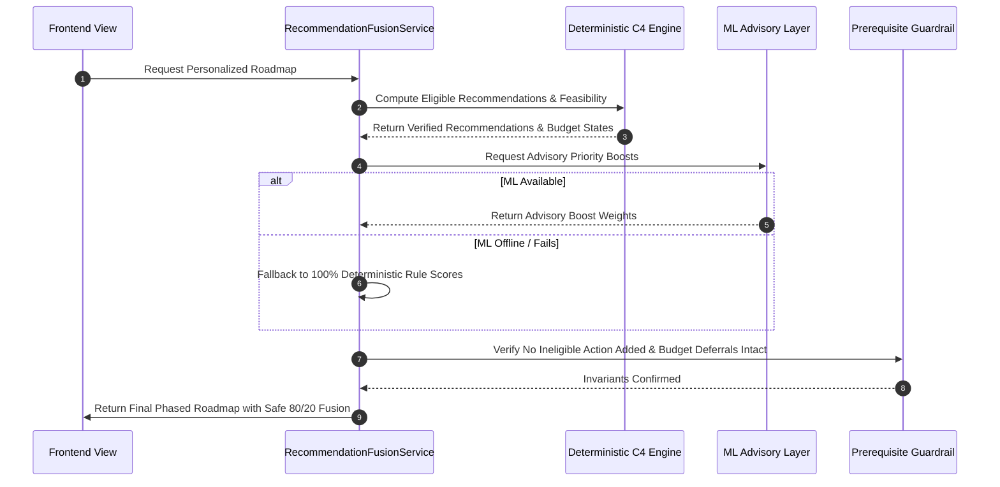

# 10. Safe Recommendation Fusion Service

## 1. Architectural Fusion Design
The `RecommendationFusionService` safely integrates machine learning advisory ranking with the deterministic C4 recommendation engine.

## 2. Inviolable Security & Guardrail Invariants
1. **Zero Unapproved Recommendations**: ML cannot inject recommendations outside C4 eligibility.
2. **Budget Primacy**: If C4 marks an item as `DEFER_DUE_TO_BUDGET`, ML cannot mark it feasible.
3. **80/20 Weighting**: Base rule score holds 80% weight; ML adjustments are bounded to 20%.\n