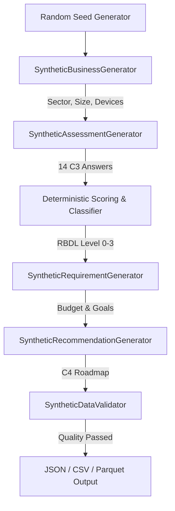

# 11. Synthetic Dataset Generation Pipeline

## 1. Generation Architecture
The synthetic generator (`backend/app/ml/synthetic/`) produces realistic, dependency-aware enterprise profiles without privacy violations.

## 2. Quality Control & Boundary Checks
The `SyntheticDataValidator` ensures 0 impossible combinations:
- No internet access cannot have cloud ERP or active ecommerce.
- Zero devices cannot claim high digital literacy or dedicated IT.
- All 11 sectors and all 4 RBDL levels are balanced and validated.\n