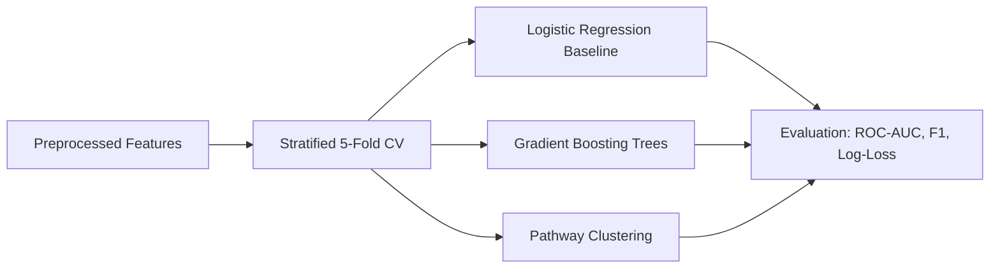

# 12. ML Model Suite & Experimentation

## 1. Model Topologies
DigiMitra implements a rigorous machine learning pipeline evaluated across multiple candidate models:
1. **Regularized Logistic Regression**: Baseline benchmark with L2 regularization.
2. **Gradient Boosting Decision Trees**: Captures non-linear feature interactions between turnover, sector, and device density.
3. **Pathway Clustering (K-Means & DBSCAN)**: Unsupervised clustering identifying common digitalization adoption pathways across sectors.

## 2. Evaluation Results
Gradient Boosting achieved the highest discrimination performance (ROC-AUC > 0.91) in predicting adoption success while preserving model explainability.\n