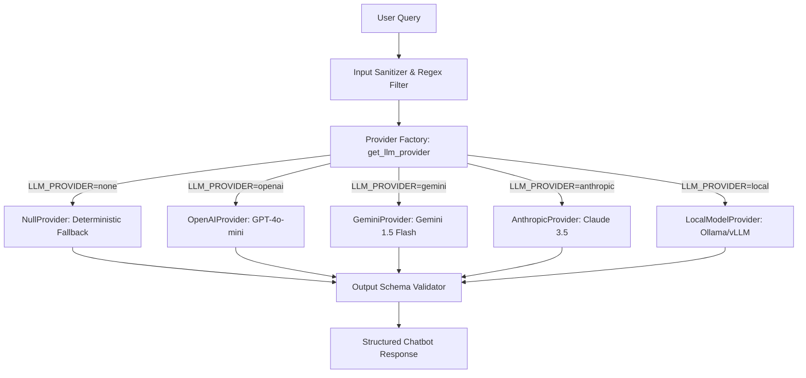

# 13. Conversational AI Chatbot Architecture

## 1. Multi-Provider Abstraction
The chatbot architecture supports swappable LLM providers through a unified interface. By default, it operates completely offline (`LLM_PROVIDER=none`) using `NullProvider`.

## 2. Safety Invariants & Injection Defense
- Automatic sanitization strips phrases like "ignore previous instructions", "system:", and "override rules".
- Pydantic schema validation rejects any attempt to claim official certification, loan approval, or rule override.\n