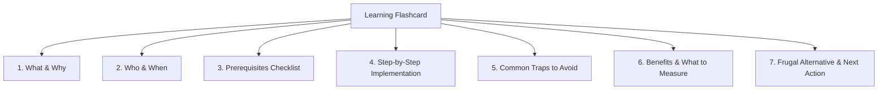

# 14. Learning Flashcards & Knowledge Nuggets

## 1. 12-Attribute Educational Framework
Each flashcard follows a standardized, highly practical 12-point structure:
1. Topic category & level badge
2. Dual-language title (English & Hindi)
3. What is it? (Simple plain-language definition)
4. Why it matters for Indian MSMEs
5. Who needs it? (Enterprise criteria)
6. When to adopt? (Readiness trigger)
7. Prerequisites checklist
8. Implementation complexity (Low, Medium, High)
9. Step-by-step implementation guide
10. Common mistakes & traps to avoid
11. Expected business benefits & KPIs
12. Low-cost / frugal alternative & Immediate next action

## 2. Level 3 Growth Flashcards
Includes advanced growth topics: Executive Dashboards (Power BI/Sheets), Customer CRM & Automated WhatsApp Loyalty, Multi-Channel Commerce via ONDC, and 3-2-1 Automated Cloud Backups.\n