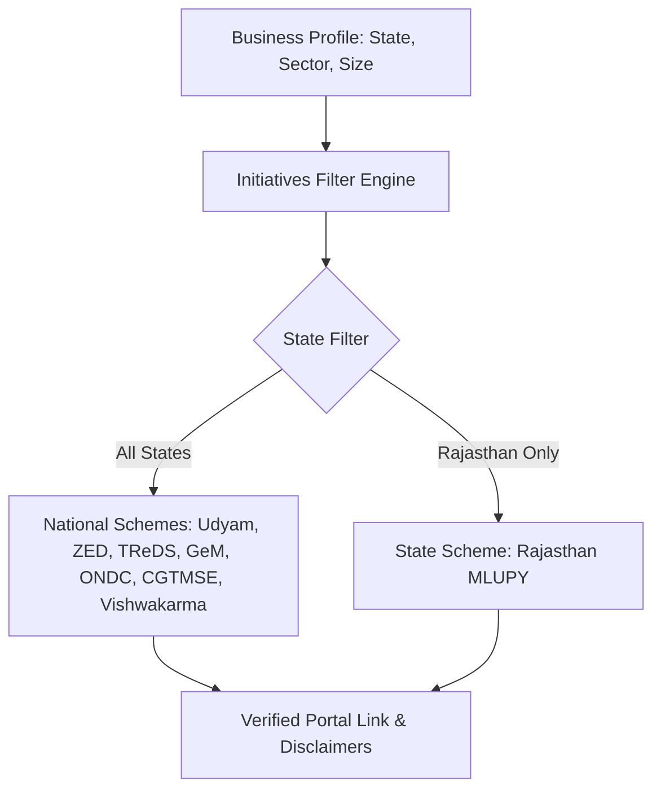

# 15. Government MSME Initiatives Knowledge Layer

## 1. Initiative Verification Framework
DigiMitra maintains a catalog of 8 verified Government of India and State digitalization assistance schemes. Every entry contains a verified official government domain URL and explicit application instructions.

## 2. Verified Schemes Catalog
1. **Udyam Registration (`GOV-UDYAM`)**: Official portal `https://udyamregistration.gov.in/`. Unlocks priority lending and government subsidies.
2. **MSME Sustainable (ZED) Certification (`GOV-ZED`)**: Official portal `https://zed.msme.gov.in/`. Subsidies for digital quality certification.
3. **Trade Receivables Discounting System - TReDS (`GOV-TREDS`)**: Official portal `https://www.rbi.org.in/`. Digital bill discounting against corporate and PSU buyers.
4. **Government e-Marketplace - GeM (`GOV-GEM`)**: Official portal `https://gem.gov.in/`. Direct procurement access to government departments.
5. **Open Network for Digital Commerce - ONDC (`GOV-ONDC`)**: Official portal `https://ondc.org/`. Open protocols for direct seller e-commerce without platform lock-in.
6. **Credit Guarantee Fund Trust for Micro and Small Enterprises - CGTMSE (`GOV-CGTMSE`)**: Official portal `https://www.cgtmse.in/`. Collateral-free business credit guarantees up to Rs 5 Crore.
7. **PM Vishwakarma Scheme (`GOV-VISHWAKARMA`)**: Official portal `https://pmvishwakarma.gov.in/`. Digital incentive, toolkit grant, and collateral-free credit for traditional artisans and trades.
8. **Mukhyamantri Laghu Udyog Protsahan Yojana - MLUPY (`GOV-RAJ-MLUPY`)**: Official portal `https://rajasthan.gov.in/`. Interest subsidy up to 8% for micro and small enterprises in Rajasthan.

## 3. Mandatory Disclaimer
DigiMitra is an independent diagnostic research platform. Schemes are administered exclusively by respective ministries and nodal banks. DigiMitra does not process applications or guarantee approvals.\n