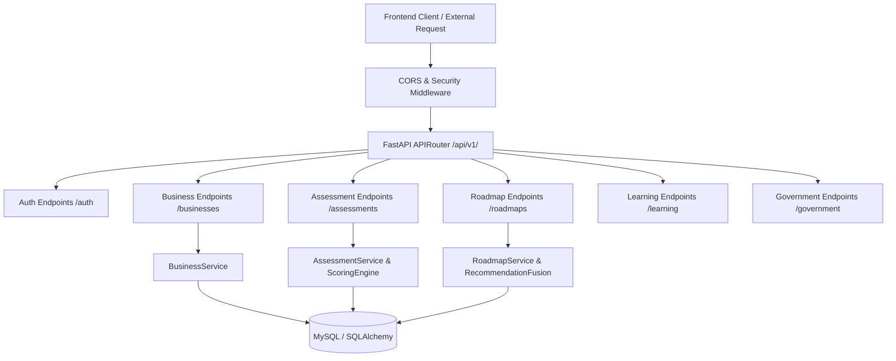

# 16. Backend Architecture & API Specification

## 1. Architecture Stack
- **Framework**: FastAPI (Python 3.11) with ASGI asynchronous handlers.
- **ORM & Migrations**: SQLAlchemy 2.0 with Alembic version-controlled schema migrations.
- **Validation**: Pydantic v2 schemas for all requests, responses, and domain entities.
- **Security**: JWT stateless Bearer tokens, passlib bcrypt password hashing, and dependency-injected session management.

## 2. Core API Endpoints
- `POST /api/v1/auth/register`, `POST /api/v1/auth/login`, `GET /api/v1/auth/me`
- `GET /api/v1/businesses`, `POST /api/v1/businesses`, `GET /api/v1/businesses/{id}`
- `GET /api/v1/businesses/categories/taxonomy`, `GET /api/v1/businesses/categories`
- `GET /api/v1/assessments/questions`, `POST /api/v1/assessments/calculate-score`, `POST /api/v1/assessments/submit`
- `GET /api/v1/roadmaps/{business_id}/active`, `PATCH /api/v1/roadmaps/tasks/{task_id}/status`
- `GET /api/v1/learning/flashcards`, `GET /api/v1/learning/flashcards/{card_id}`
- `GET /api/v1/government/initiatives`, `GET /api/v1/government/initiatives/{initiative_code}`\n