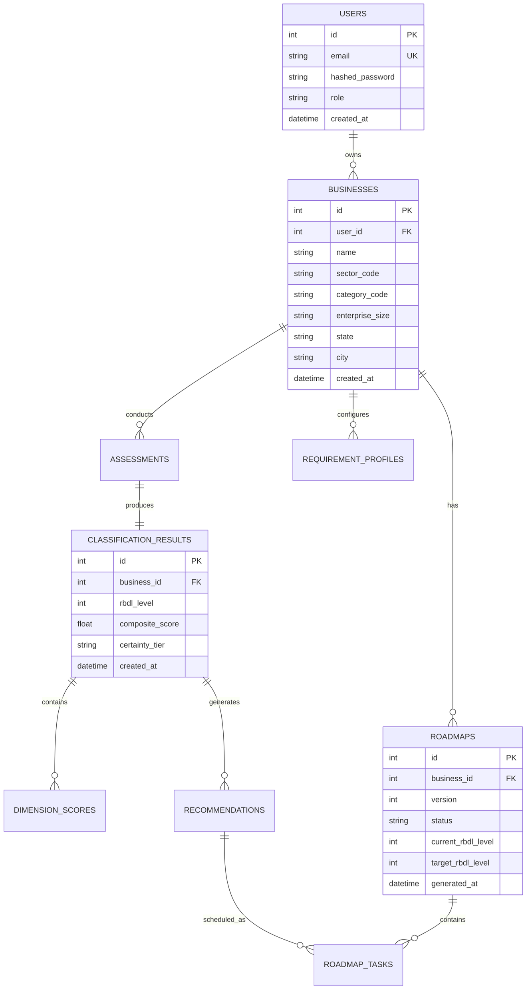

# 17. Database Schema & Migration Guide

## 1. Relational Entity Relationship Diagram (ERD)
The database structure is normalized, maintaining full relational integrity and auditability.

## 2. Alembic Migration Chain
The database schema is managed via linear Alembic migrations:
1. `a1b2c3d4e5f6`: Initial core schema (users, businesses, assessments).
2. `b2c3d4e5f6a1`: Classification results and dimension score tables.
3. `c3d4e5f6a1b2`: C4 recommendations and roadmap tables.
4. `d4e5f6a1b2c3`: Requirement profile V1 table.
5. `e5f6a1b2c3d4`: Progress tracking and historical comparison tables.
6. `f6a1b2c3d4e5`: Security and audit logging enhancements.
7. `h8b9c0d1e2f3`: Research evaluation infrastructure tables.
8. `i9c0d1e2f3a4`: Business taxonomy expansion (11 sectors, 49 subcategories, needs, tools, paths).\n