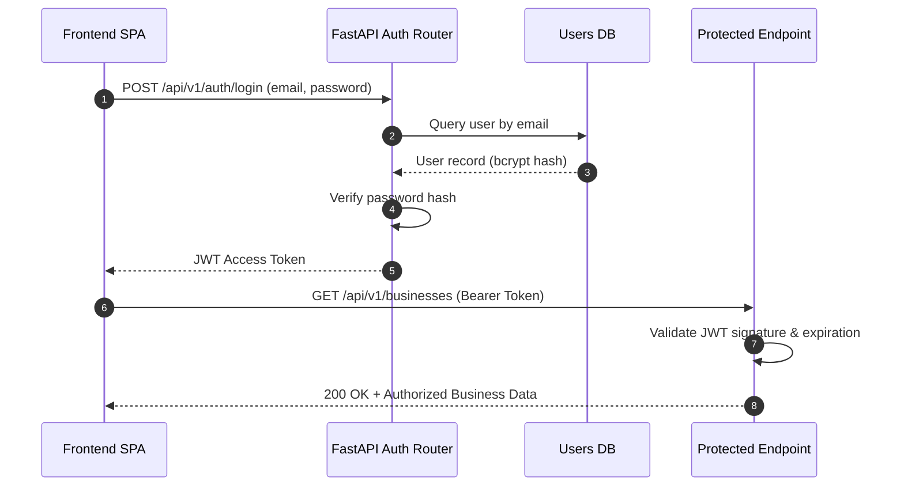

# 18. Security, Authentication & RBAC

## 1. Authentication Architecture
- **Password Protection**: Passwords hashed using `bcrypt` with automatic salting (work factor 12).
- **Session Tokens**: Stateless JSON Web Tokens (JWT) signed with HMAC-SHA256 (`HS256`).
- **Token Expiry**: Configurable TTL (default 1440 minutes = 24 hours).
- **Transport Security**: Enforced HTTPS in production; strict CORS policy restricting allowed origins.

## 2. Role-Based Access Control (RBAC)
- `business_owner`: Access and manage owned enterprises, assessments, and roadmaps.
- `researcher`: Read-only access to anonymized assessment cohorts and evaluation metrics.
- `administrator`: Full access to taxonomy management, audit logs, and system configuration.\n