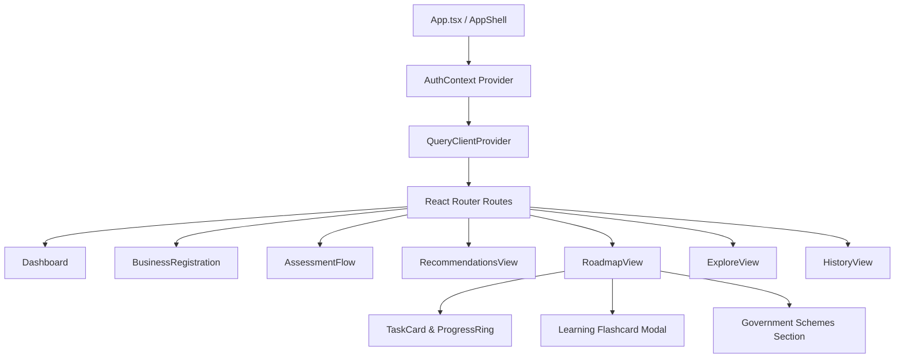

# 19. Frontend Architecture & Design System

## 1. Frontend Technology Stack
- **Framework**: React 18 with TypeScript.
- **Build Tool**: Vite 5 with Rollup tree-shaking production bundling.
- **State & Data Fetching**: TanStack React Query v5 for asynchronous server-state caching and invalidation.
- **Routing**: React Router DOM v6.
- **Icons**: Lucide React.
- **Design System**: Vanilla CSS tokens tailored for Indian enterprise aesthetics (Warm terracotta `#F0592A`, dark espresso `#241C15`, cream `#FFF9F5`, border `#EDE2D8`).

## 2. Component Hierarchy & Atomic Design
- Primitives: `Button`, `Badge`, `Card`, `StatCard`, `Tabs`, `Input`, `Select`, `Alert`, `LoadingState`, `EmptyState`.
- Domain Components: `LevelBadge`, `LevelCard`, `ProgressRing`, `DimensionCard`, `TaskCard`, `ResearchDisclosureBanner`.\n