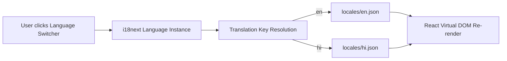

# 20. Internationalization (i18n) Framework

## 1. Bilingual Architecture
DigiMitra is built from the ground up to support dual-language fluency in English and Hindi (`hi-IN`).

## 2. Domain Localization Features
- All 14 C3 questions, option choices, and explainability notes are translated into clear, natural Hindi.
- All recommendations, rationale bullet points, and roadmaps display bilingual descriptions based on user selection.
- All 12 attributes in Learning Flashcards and Government Initiatives are fully localized.\n