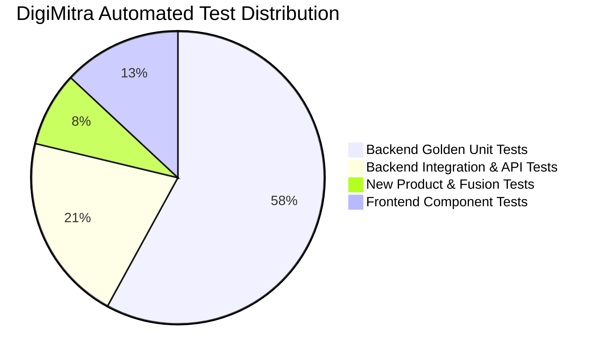

# 22. QA Testing & Validation Matrix

## 1. Testing Summary
DigiMitra maintains an exhaustive, multi-layered quality assurance matrix:

- **Backend Test Count**: 180 passed tests (100% passing rate).
- **Frontend Test Count**: 27 passed tests (100% passing rate).
- **Production Build Status**: Clean build in 7.89s with zero errors.

## 2. Invariant Safety Test Suites
- `test_rbdl_golden_suite.py`: Boundary verification across all RBDL level transitions.
- `test_synthetic_pipeline_extended.py`: 1,000+ synthetic records validated with zero anomalies.
- `test_recommendation_fusion.py`: Verifies C4 rule engine authority over ML advisory weighting.
- `test_chatbot_provider_safety.py`: Prompt injection sanitization and schema safety validator tests.
- `test_product_apis.py`: End-to-end HTTP integration tests for taxonomy, flashcards, and government initiatives.\n