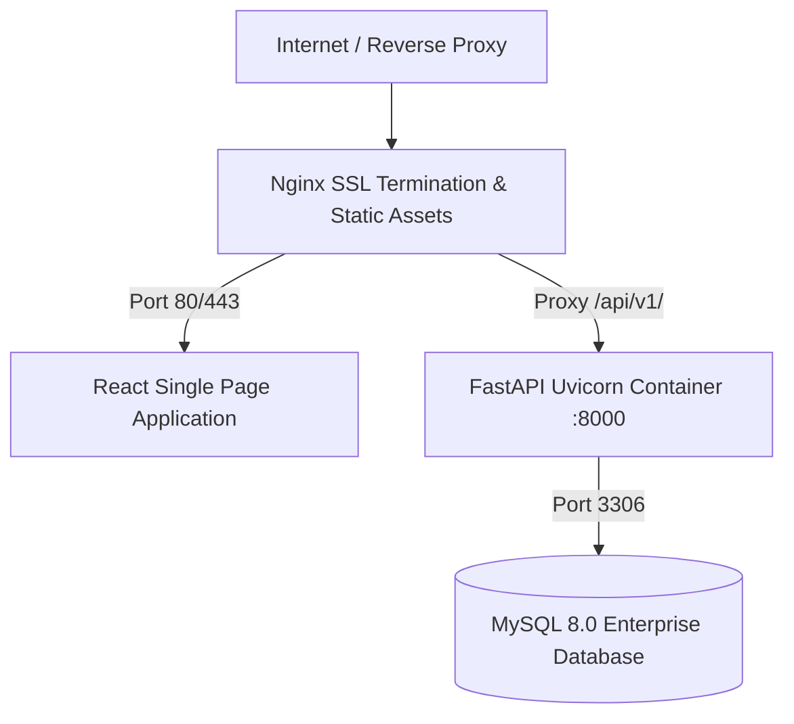

# 23. DevOps, Containerization & Deployment

## 1. Containerization Topology
The platform is containerized using Docker and Docker Compose for zero-configuration reproducible deployment across local development, staging, and production environments.

## 2. Dockerfile Specifications
- Multi-stage Dockerfile for FastAPI backend with non-root user execution (`python:3.11-slim`).
- Multi-stage Dockerfile for React frontend using Node 20 builder and Nginx alpine runtime.
- Healthcheck endpoints (`GET /api/v1/health`) for container orchestration readiness.\n