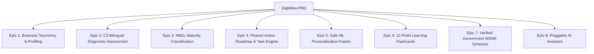

# 25. Product Requirements Document (PRD)

## 1. Purpose & Scope
This PRD outlines the functional and technical requirements for DigiMitra as a complete, usable, commercially viable product for Indian MSMEs.

## 2. Non-Functional Requirements
- **Response Time**: All diagnostic and recommendation queries must resolve within 500 ms.
- **Availability**: 99.9% uptime target with automated healthchecks.
- **Data Privacy**: No business proprietary data or customer phone numbers sold, shared, or exposed to external LLMs.\n