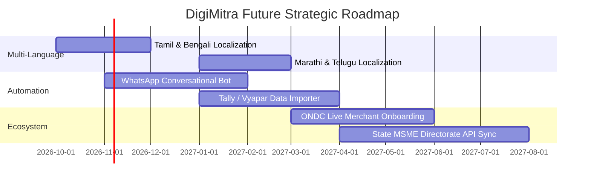

# 26. Future Product Roadmap

## 1. Near-Term Horizon (Q4 2026 - Q1 2027)
- **Vernacular Language Expansion**: Addition of Tamil (தமிழ்), Bengali (বাংলা), Marathi (मराठी), and Telugu (తెలుగు).
- **WhatsApp Bot Integration**: Conversational assessment completion and milestone reminders directly via WhatsApp Business Cloud API.
- **ONDC Sandbox Connector**: Direct 1-click catalog upload to ONDC-enabled buyer apps.

## 2. Long-Term Horizon (2027+)
- Open-source DigiMitra engine for government MSME facilitation centers (DICs) across India.
- Cross-border export readiness module for ODOP (One District One Product) artisans.\n